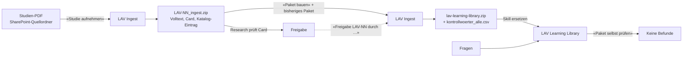

# Architektur

Stand: 10.11.2026. Wie die LAV Learning Library aufgebaut ist: Agenten, Datenfluss, Dateiformate, Skripte.
Begründungen stehen in [entscheide.md](entscheide.md), Plattformfakten in [plattform.md](plattform.md).

## Ziel und Killerkriterium

Eine Learning Library über 25 (Start) bis höchstens rund 60 interne LAV-Studien der Helsana (PDF: Foliendecks mit
vielen Grafiken und textlastige Berichte). Ein Agent in Microsoft Copilot Studio beantwortet jede Frage aus dem
**vollständigen** Inhalt der **richtigen** Studie, mit Seitenbeleg, ohne erfundene Zahlen.

Vier prüfbare Anforderungen:
1. **Richtige Studie:** Der Agent bestimmt die Studie eindeutig oder fragt nach, wenn zwei passen.
2. **Vollständig gelesen:** Bei Fragen zu einer Studie liest er alle Teile ihres Volltexts, nachweisbar über Kontrollwörter.
3. **Belegte Zahlen:** Jede Aussage trägt `[LAV-XX, S. n]`, jeder Grafikwert seinen Wertstatus.
4. **Sichtbare Lücken:** Was die Studien nicht belegen, sagt er ausdrücklich.

Nicht-Ziele: keine Websuche, kein Weltwissen, keine eigenen Empfehlungen, die als Studienaussage erscheinen.

## Zwei Agenten

| Agent | Nutzerkreis | Skill (ZIP) | Aufgabe |
|---|---|---|---|
| **LAV Ingest** | nur Pflegeteam | `lav-ingest.zip` = `dist/lav-ingest.zip` aus `src/lav-ingest/` | Studien-PDF transkribieren und prüfen; Library-Paket bauen und prüfen; Wiki-Seiten erzeugen |
| **LAV Learning Library** | später Nutzerkreis nach Gate G2 | `lav-learning-library.zip`, erzeugt im Tenant mit «Paket bauen»; Vorlage `src/lav-learning-library/` | Fragen beantworten; Wartungsbefehle «Paket selbst prüfen», «Belege prüfen» |

Beide: Copilot Studio, **GitHub Copilot Harness** (Sandbox mit Python), Modell GPT-6 Astra, kein Knowledge, Websuche
aus, Memory aus. Der dritte Agent «LAV Plattformtest» (Phase A) wird nicht mehr gebraucht.

## Datenfluss



Alle Ergebnisse (Ingest-ZIP, Paket, Kontrollwort-Listen) liegen im SharePoint-Quellordner «LAV Library – Quelle»
(je Studie ein Ordner LAV-NN mit Original-PDF und `LAV-NN_ingest.zip`). Die Sandbox speichert nichts über ein
Gespräch hinaus. Interne Studien werden nur im Tenant verarbeitet; dieses Repository und VS Code sehen sie nie.

## Ingest einer Studie («Studie aufnehmen»)

Ablauf laut `src/lav-ingest/SKILL.md`:
1. `inventar.py <pdf> arbeit/LAV-NN` – Seitentabelle (Typ je Seite, Textebene, Doppelseiten), Rohtext je Seite
   (bei Doppelseiten getrennt nach linker und rechter Hälfte), Seitenbilder.
2. Transkription in **Etappen** à höchstens 5 Seiten, höchstens `ETAPPEN_PRO_ANTWORT` = 2 Etappen pro Antwort, danach
   «weiter». Je Seite eine Datei `seiten/sNNN.md`, wörtlich aus der Textebene, Struktur nach dem Seitenbild, Grafiken als
   Block mit Wertstatus. Nach jeder Etappe `pruefen.py --nur-vorhandene`; Meldungen «unbearbeiteter Rohtext»,
   «Silbentrennung am Zeilenende», «zerlegte Textzeilen» werden immer behoben, nie begründet.
3. Ab 40 Seiten alle 20 Seiten (`ZWISCHENSTAND_ALLE`) ein Zwischen-ZIP; Unterbruch → neues Gespräch, «Fortsetzen».
4. Schlussprüfung `pruefen.py`; jede Meldung behoben oder in `befunde-begruendet.txt` begründet.
5. `aufteilen.py … --max TEILGROESSE` (45’000 Bytes) → `volltext/teil-NN.md`, `kontrollwoerter.csv`, `katalog-zeile.txt`.
6. `card.md` und `katalog-eintrag.md` nach `references/vorlagen.md`, nur aus dem geprüften Volltext.
7. `grafiken-abgelesen.txt` für die Sichtprüfung durch einen Menschen.
8. Ausgabe `LAV-NN_ingest.zip`.

Inhalt eines Ingest-ZIPs (Beispiel LAV-T01, 33 Dateien): `seiten/s001.md …`, `volltext/teil-NN.md`, `card.md`,
`katalog-eintrag.md`, `kontrollwoerter.csv`, `katalog-zeile.txt`, `pruefprotokoll.txt`, `befunde-begruendet.txt`,
`grafiken-abgelesen.txt`, `zeiterfassung.csv`, `inventar.txt` (teils auch `abschlussstatus.txt`, `card-pruefung.txt`,
`grafikwerte-methodik.txt`). Die Ingest-ZIPs der Teststudien liegen in `testdaten/ingest/`.

## Library-Paket (`lav-learning-library.zip`)

```
SKILL.md                                  Anweisungen (Vorlage: src/lav-learning-library/SKILL.md)
references/00-katalog.md                  alle Studien: ID, Titel, Aliasse, Verwechslungshinweise, Volltext-Teile
references/01-study-cards.md              geprüfte Zusammenfassung je Studie (bei Bedarf -1, -2 …)
references/volltext/LAV-XX/teil-NN.md     lückenloser Volltext in Teilen ≤ 45’000 Bytes, nur an Seitengrenzen geteilt
scripts/paket.py, scripts/belege.py       Prüfwerkzeuge für das Pflegeteam (Wartungsbefehle)
```

Drei Ebenen mit Lesepflicht: Katalog bei jeder Anfrage; Cards bei übergreifenden Fragen; Volltext einer Studie
vollständig bei Fragen zu ihr (Fall A), bei übergreifenden Fragen vollständig oder nach Wegweiser der Card (Fall B).
Kontrollwort-Listen liegen nie im Paket.

Grössen: Katalog-Eintrag höchstens ca. 600 Zeichen; Card höchstens ca. 3’000 Zeichen; jede Datei unter references/
höchstens `TEILGROESSE` = 45’000 Bytes (UTF-8). «Paket bauen» verteilt Katalog und Cards bei Bedarf auf mehrere Dateien.

## Dateiformate (Verträge zwischen Skripten – nur zusammen mit Skripten und Tests ändern)

| Element | Format | Erzeugt / geprüft von |
|---|---|---|
| Seitenmarker | `[[Seite n/N]]`, bei abweichender Druckseite `[[Seite n/N · Druckseite x]]` bzw. `· Druckseiten x–y` | Ingest-Agent / pruefen.py, aufteilen.py, paket.py, belege.py |
| Kopf eines Teils | `# LAV-XX · Volltext · Teil i von n (PDF-Seiten a–b von N)` + Zeile `Studie: … · Quelldatei: … · Transkript-Version x.y · Datum` | aufteilen.py / paket.py |
| Schluss eines Teils | `— Ende Teil i von n · Kontrollwort Teil i: WORT-NN · weiter mit teil-0k.md —`, letzter Teil `· DOKUMENTENDE LAV-XX —` | aufteilen.py / paket.py |
| Katalog | Kopf `Stand: JJJJ-MM-TT · N Studien · Skill-Version x.y`; Einträge `## LAV-XX · Kurztitel Jahr`; Schluss `— Ende Katalog · Kontrollwort: WORT-NN —` | paket_bauen.py / paket.py |
| Cards | Kopf `Stand: … · N Cards · Datei i von k`; Card endet mit `— Ende Card LAV-XX —`; Datei endet mit `— Ende Study Cards Datei i von k · Kontrollwort: WORT-NN —` | paket_bauen.py / paket.py |
| Freigabe | Zeile `Freigegeben: Name, Research · JJJJ-MM-TT · Volltext-Version x.y` (offen: `Freigegeben: –` oder `ausstehend`) | paket_bauen.py `--freigabe` |
| Kontrollwort | `[A-Z]+-NN` aus einer Liste Schweizer Berge und Alpenpflanzen, zufällig, eindeutig im Paket | aufteilen.py, paket.py `--erneuern`, paket_bauen.py |
| Wertstatus | `beschriftet` · `abgelesen ca.` · `berechnet` (nur per Skript, mit Genauigkeit) · `nicht eindeutig ablesbar` | Ingest-Agent / pruefen.py (Grafikblock ohne Status = Befund) |
| Grafikblock | `**[Grafik k] Titel**` … `**[Ende Grafik k]**` mit Frage, Darstellung (inkl. Wertstatus), Tabelle, Quelle | Ingest-Agent / pruefen.py |
| Beleg in Antworten | `[LAV-XX, S. n]` bzw. `[LAV-XX, S. n (Druckseite x)]`, n = PDF-Seite | Library-Agent / belege.py |
| Kontrollwort-Liste | CSV `datei;kontrollwort[;seiten;bytes;datum]` – nie in einen Agenten | aufteilen.py, paket.py `--csv` |
| Golden Set | CSV (UTF-8 mit BOM, `;`): `id;typ;studien;frage;sollantwort;belege;bestanden_wenn` | Menschen / Auswertung |

Regeln je Element der Transkription: `src/lav-ingest/references/transkriptionsregeln.md`.
Vorlagen für Katalog-Eintrag und Card: `src/lav-ingest/references/vorlagen.md`.

## Antwortverhalten des Library-Agenten (SKILL.md v1.2, Kurzfassung)

- Nur aus den Dateien der Skill; jede inhaltliche Aussage mit `[LAV-XX, S. n]`; Lücken ausdrücklich als «in den
  Studien nicht belegt».
- Jede Datei vollständig lesen; gelesen ist sie erst mit der Kontrollwort-Zeile.
- Fall A (eine Studie): Studie bestimmen (bei zwei Kandidaten nachfragen), alle Teile lesen, belegt antworten.
  Fall B (mehrere Studien): Cards, dann Volltexte. Fall C: Katalog- und Metafragen, Lesebeweis.
  Fall D: nicht abgedeckt → «In den Studien der Library nicht belegt.»
- Zahlenregeln: Wertstatus übernehmen; zu jeder Zahl Gruppe/Region, Basis, Jahr/Ausgabe, Art des Werts; Veränderungen
  in Prozentpunkten; Selbstgerechnetes als «berechnet» mit Ausgangswerten; Beleg am Ende des Absatzes, bei Tabellen und
  Listen ohne eigene Belege im Satz davor.
- Inhaltsregeln: falsche Annahmen der Frage zuerst richtigstellen; Ursache nur, wenn die Studie sie nennt, mit deren
  Vorsicht und als Deutung gekennzeichnet; bei Vergleichen Methodenwechsel nennen.
- «Redaktionelle Einordnung LAV» in Cards ist keine Studienaussage und wird nie mit Seitenbeleg zitiert.
- Abschluss jeder fachlichen Antwort: `Gelesen: Katalog ✓ · Study Cards … · Volltext …` und `Nicht belegt: …`.
- Wartung (nur Pflegeteam): «Paket selbst prüfen» (`paket.py --selbst`), «Belege prüfen» (`belege.py`).

## Skripte

| Skript | Ort | Zweck |
|---|---|---|
| `inventar.py` | Ingest | Inventar der PDF, Rohtext je Seite (Doppelseiten getrennt), Seitenbilder. Braucht pdfplumber. |
| `pruefen.py` | Ingest | Transkript gegen die Textebene: Seiten vollständig, Seitenmarker, Zahlen mit Häufigkeit (Achsen ausgenommen), Wortabdeckung ≥ 95 %, Grafikblöcke mit Wertstatus, Rohtext-Befunde. |
| `aufteilen.py` | Ingest | Teile nur an Seitengrenzen, Grösse in Bytes, Kopf und Schlusszeile, zufällige Kontrollwörter, `katalog-zeile.txt`. |
| `paket.py` | beide | Paketprüfung (Struktur, Schlusszeilen, Kontrollwörter eindeutig, Grössen, Teile lückenlos, Katalogzeile, Cards, Card-Zahlen auf der zitierten Seite, «Nicht verwechseln mit» bei Ausgaben derselben Reihe); `--erneuern`, `--ausgabe`, `--csv`, `--selbst`. |
| `paket_bauen.py` | Ingest | «Paket bauen»: Ingest-ZIPs (+ bestehendes Paket) → geprüftes Library-Paket. Siehe unten. |
| `belege.py` | beide | «Belege prüfen»: jede Zahl einer Antwort gegen die zitierte Seite; Status gefunden / nicht gefunden / berechnet – Rechnung prüfen / in Aussage «nicht belegt» / keine Seitenangabe. |
| `wiki.py` | Ingest | Wiki-Seiten (index.md, LAV-XX.md) aus dem Paket, ohne Kontrollwörter und Volltexte. |

Alle Skripte: Python 3.12 (Sandbox), nur Standardbibliothek (inventar.py, pruefen.py zusätzlich pdfplumber), kein
Netzwerk, Ausgaben auf Deutsch, Exit-Code 0 = keine Befunde, 1 = Befunde, 2 = Fehler.
`src/lav-ingest/references/skripte.md` enthält alle Skripte als Text (Ersatzweg, falls Skripte nicht direkt laufen);
die Datei wird von `tools/build.py` erzeugt.

## «Paket bauen» (paket_bauen.py)

1. Eingaben einsammeln: Ingest-ZIPs einzeln, ZIPs in einem ZIP (bis 2 Ebenen), höchstens ein bestehendes Library-Paket.
   Im Tenant immer `--uploads`: Das Skript liest alle ZIPs im Upload-Ordner selbst, weil die Plattform Befehle mit
   Upload-Pfad sperrt (siehe plattform.md).
2. Je Studie prüfen: ID in Katalog-Eintrag, Card und Volltext-Köpfen gleich; Teile vorhanden.
3. Neue Ingest-Ergebnisse ersetzen Studien gleicher ID aus dem bestehenden Paket; übrige werden übernommen;
   `--entfernen LAV-NN`.
4. Freigaben setzen (`--freigabe "LAV-NN=Name, Research"` oder `"*=Name"`; Datum = heute). Nicht freigegebene Cards
   sind kein Befund, werden aber gemeldet (= Testpaket).
5. Ausgaben derselben Reihe (gleicher Titel ohne Jahr) gegenseitig unter «Nicht verwechseln mit» eintragen
   (frühere / spätere Ausgabe).
6. Doppelte Kontrollwörter der Volltexte zwischen Studien durch neue ersetzen (bei 25 Studien sonst rund 40 % Risiko).
7. Katalog und Cards nach ID sortiert zusammensetzen, bei Bedarf auf mehrere Dateien verteilen; SKILL.md aus der
   Vorlage `assets/library-SKILL.md`; `scripts/paket.py`, `scripts/belege.py` dazu.
8. `paket.py --erneuern` prüfen lassen, ZIP und `kontrollwoerter_alle.csv` schreiben. Ausgabe nur ohne Befunde verwenden.

## Repository und Build

- Quelle der Ingest-Skill: `src/lav-ingest/`; Quelle der Library-Skill (Vorlage): `src/lav-learning-library/`.
- `python tools/build.py`: gleicht abgeleitete Dateien ab (`assets/library-SKILL.md`, `scripts/belege.py` in der
  Ingest-Skill, `scripts/paket.py` in der Library-Skill, `references/skripte.md`), führt alle Tests aus und baut
  `dist/lav-ingest.zip` (nur wenn sich der Inhalt ändert; feste Zeitstempel, LF-Zeilenenden). Prüfsumme in
  `dist/PRUEFSUMMEN.txt`.
- Das Library-Paket entsteht nicht im Repository, sondern im Tenant («Paket bauen»), weil es interne Studien enthält.
  Für Tests gibt es `testdaten/library/lav-learning-library_3-studien_v1.1.zip` (öffentliche Teststudien).
